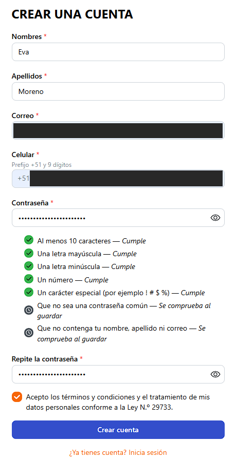
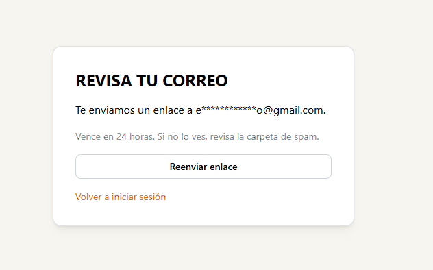
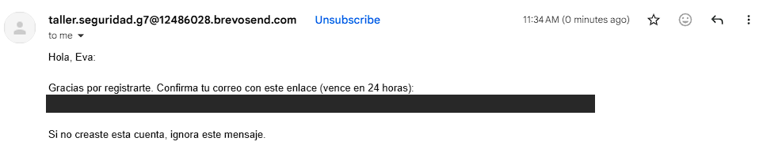
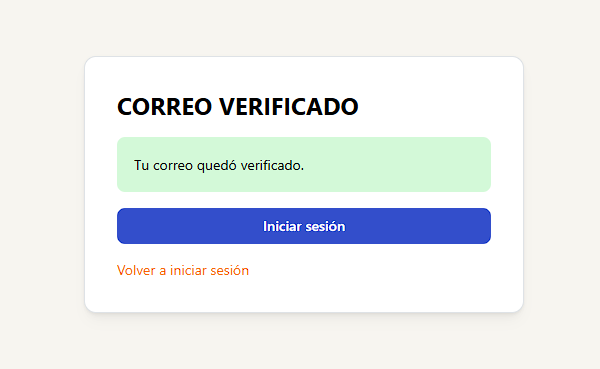
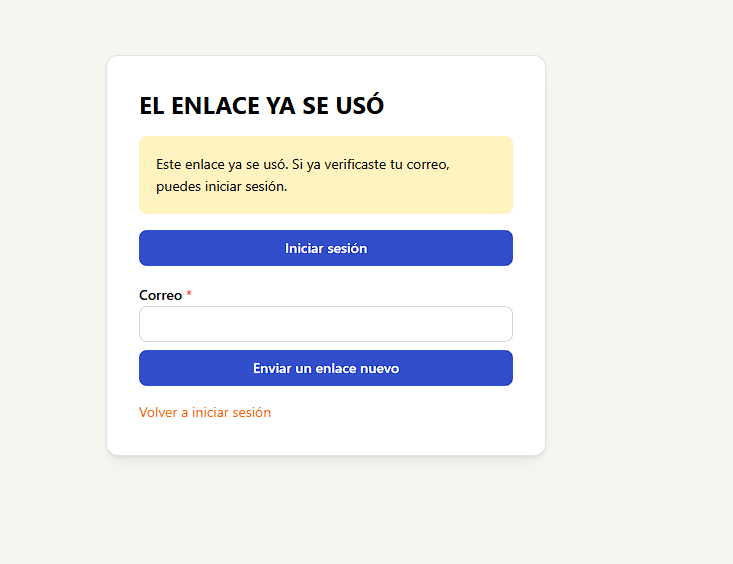
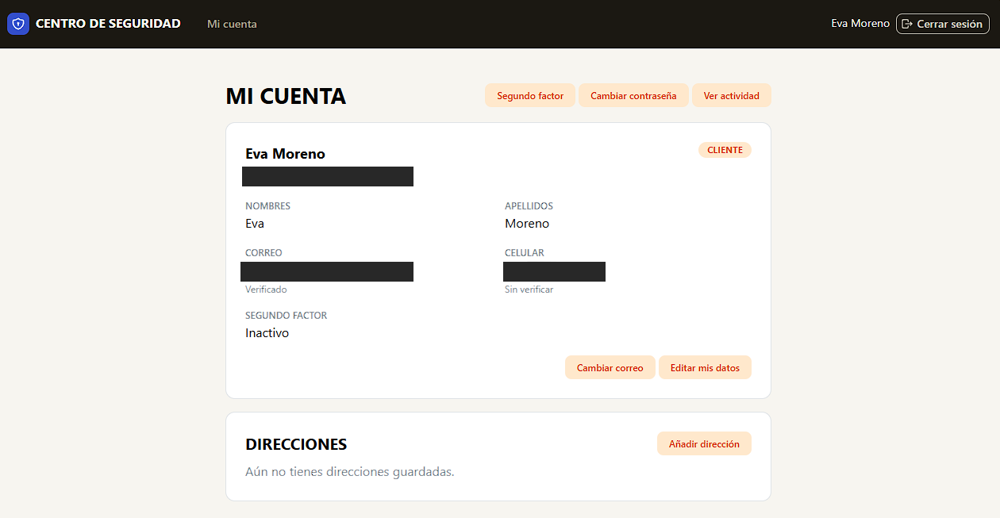
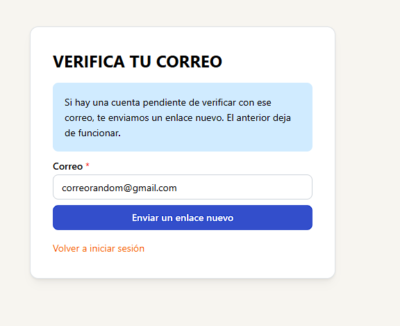

# FEAT-01 — Registro y verificación de correo (G1 F-001)

Responsable: Eva Lucía Moreno Zevallos. Corte: 6-nov-2026, America/Lima.
Estado: **T1–T5 implementadas, fusionadas y desplegadas; T6 con recorrido desplegado propio
comprobado**. No se declaran Verificados todos los RF: los límites se enumeran al final.

## Fuentes y versiones

SPEC-01, SPEC-02, FRONT-02, FRONT-03 (retorno por canal, docs #71), OpenAPI v1 (`/auth/registro`
con la corrección de RETAIL de docs #77) y catálogos de errores y eventos. Evidencia de código y
pruebas en el repo backend: `docs/evidencia/FEAT-01.md`.

| Componente | PR fusionado | Commit de merge | URL |
|---|---|---|---|
| Backend (T1–T4) | [#61](https://github.com/Taller-SW-Web/Modulo-de-Seguridad-Backend/pull/61) | `d60befab174e7ce7c717b88947456f8dcbd65b9d` | https://g7-auth-service.onrender.com |
| Backend (lote para FEAT-06) | [#74](https://github.com/Taller-SW-Web/Modulo-de-Seguridad-Backend/pull/74) | `0dd5de6d9a78e991376615f33a90b4c62cc3218d` | — |
| Frontend (T4 SPA, T5) | [#16](https://github.com/Taller-SW-Web/G7-Modulo-de-Seguridad-Frontend/pull/16) | `319b20265301beecdb1ee7b5f42ef146b0ec6e19` | https://g7-seguridad-spa.onrender.com |

Versiones Live observadas por David el 6-nov (captura de Render en [FEAT-11](FEAT-11.md)): backend
`92086c16ed82bc85851031ea75e2909bb87c7fb1` y frontend `cbe2f00`. Comprobado con `git merge-base`:
el backend `92086c1` contiene `d60befa` y `0dd5de6`, y el frontend `cbe2f00` contiene `319b202`
(incluido el ajuste de RETAIL `547ae10`). No se adjuntó una captura de Render propia: la versión
efectiva en el momento exacto del recorrido se infiere de esa observación del mismo día.

## Recorrido desplegado (T6)

Ejecutado por Eva el 6-nov-2026 entre las 11:33 y las 11:39 (America/Lima), en la SPA desplegada,
con una cuenta nueva de su correo personal. Capturas recortadas sin barra de direcciones y con
correo, celular y enlace tapados.

| # | Paso | Resultado | Captura |
|---|---|---|---|
| 1 | Formulario de registro (FRONT-02) | Medidor de la política en vivo: reglas visibles cumplidas, «común» y «datos personales» para el guardado |  |
| 2 | Crear cuenta | 201 → «Revisa tu correo» con el correo enmascarado; sin sesión |  |
| 3 | Correo de verificación | Llegó en el mismo minuto del registro (11:34), enviado por Brevo, con el enlace a `/verificar-correo` y vigencia de 24 horas |  |
| 4 | Abrir el enlace | 204 → «Tu correo quedó verificado» y botón «Iniciar sesión» |  |
| 5 | Abrir el mismo enlace otra vez | 410 `ENLACE_YA_USADO` → «Este enlace ya se usó» con reenvío |  |
| 6 | Iniciar sesión con la cuenta nueva | «Mi cuenta» con correo **Verificado** y rol `CLIENTE` |  |
| 7 | Reenvío a un correo sin cuenta | 202 → mensaje neutro, igual exista o no la cuenta |  |

Además, David registró una cuenta **desde G1**, recibió el correo, verificó en G7 y **volvió al
login de G1** ([FEAT-11](FEAT-11.md), «Registro y verificación»): acredita el retorno por canal
`MARKETPLACE` de T4 en despliegue.

## Pruebas automatizadas

- Backend: **1005/1005** con develop al día al fusionar #74 (`./gradlew test`), incluidas las 11
  pruebas PostgreSQL de punta a punta de `RegistroClientePostgresTest` (token solo por hash, correo
  cifrado, verificación única con `usuario.creado` y `roles` en lista, cuota de reenvío con la cola
  caída, `&canal=` en el enlace) y 100 IDs en 2 consultas para `leerLote`. CI verde en #61 y #74.
- Frontend: **128/128** (30 de FEAT-01, escenarios UI-02.1–02.7 y UI-03.1–03.9), `tsc`, `eslint` y
  build correctos. CI verde en #16.

## Límites

- No se recorrieron en el despliegue todos los errores: 409, 422, enlace vencido y 429 están
  cubiertos solo por las pruebas automatizadas.
- `RETAIL` comparte el retorno de `MARKETPLACE` (decisión del PO del 26-oct); no se probó desde
  Retail. `CHATBOT` usa nuestra pantalla: su pantalla propia (RF-02.8) queda pendiente.
- La versión de los términos guardada es la de `G7_REGISTRO_VERSION_TERMINOS`; el texto vigente de
  los términos sigue sin URL (H-12).
- FEAT-02 (baja y reactivación, P2) no se inició en H4 y pasa a H5.
- No se incluyen contraseñas, tokens, enlaces de correo ni datos personales completos.
