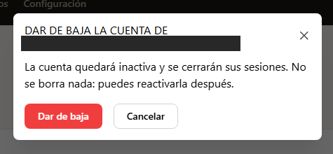
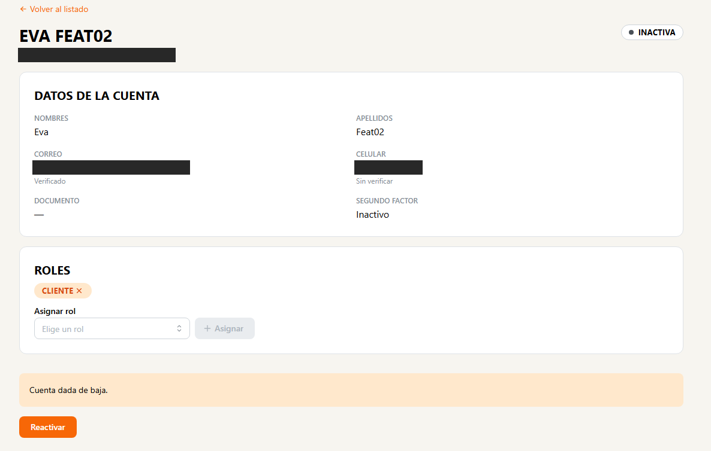
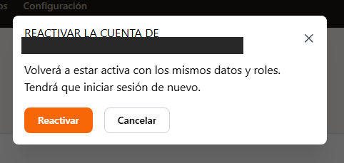
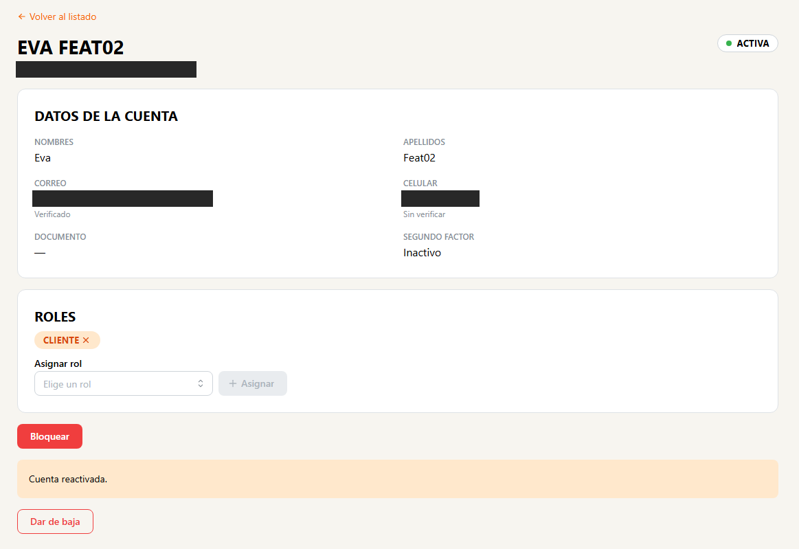

# FEAT-02 — Baja y reactivación de cuentas, en el despliegue

Responsable: Eva Lucía Moreno Zevallos. Corte: 23-nov-2026, America/Lima.
Estado: **FEAT-02-T1 cerrada: baja, ingreso rechazado y reactivación comprobados en el
despliegue.**

Continúa la [evidencia H4 de FEAT-01](../h4/FEAT-01.md), donde FEAT-02 quedó como límite: el
backend se había fusionado el 7-nov, pero la pantalla seguía en revisión.

## Fuentes y versiones

| Componente | Referencia |
|---|---|
| Especificación | [SPEC-04](../../../specs/funcionales/SPEC-04-baja-reactivacion.md) RF-04.1 y RF-04.3, ESC-04.1 y ESC-04.3; textos de [FRONT-07](../../../specs/front/FRONT-07-admin-listado-usuarios.md) y acciones de [FRONT-08](../../../specs/front/FRONT-08-admin-detalle-usuario.md) |
| Backend | [#84](https://github.com/Taller-SW-Web/Modulo-de-Seguridad-Backend/pull/84) (merge `4ca6cf1`). Desplegado: `05ad567d16d1323c1b13711aeb83f6ee5f041254`, que contiene `4ca6cf1` (comprobado con `git merge-base`) |
| Frontend | [#21](https://github.com/Taller-SW-Web/G7-Modulo-de-Seguridad-Frontend/pull/21) (merge `479f2b5`). Desplegado: `a7064178928727c30279cae6e2dfd0aba2dfee41`, que contiene `479f2b5`. David lo publicó el 23-nov; el bundle servido (`index-9oQgVo7i.js`) ya trae «Dar de baja» y «Reactivar» en el detalle |
| URL | https://g7-auth-service.onrender.com/api/v1 · https://g7-seguridad-spa.onrender.com |
| Guion | [`guiones/FEAT-02-baja-reactivacion.ps1`](guiones/FEAT-02-baja-reactivacion.ps1) |

## Ejecución

**Nivel de evidencia:** propia desplegada. **Fecha:** 23-nov-2026, de 09:39:41 a 09:43:50,
America/Lima. **Ejecutó:** Eva.

- **Cuenta probada:** una `CLIENTE` desechable, registrada y verificada ese día con un alias del
  correo de Eva. No es la cuenta de FEAT-01 ni la del gestor de FEAT-13.
- **Baja y reactivación:** desde el detalle de la SPA, con una cuenta `ADMIN_SISTEMA`, mientras el
  guion esperaba.
- **Qué se muestra:** el guion lee la contraseña con `Read-Host -AsSecureString` y solo imprime
  estados HTTP y códigos de error. No hay contraseñas ni tokens en esta evidencia.
- **Control previo del guion:** tras la revisión de Luis en #112, el guion se detiene si la
  renovación previa a la baja no responde `200` con un refresco nuevo; así un `401` posterior no se
  puede atribuir a un token que ya era inválido. Ese control se añadió **después** de esta ejecución,
  que corrió con la versión anterior del guion. El resultado no cambia, porque en ella la renovación
  previa respondió `200` (09:39:42).

| Hora | Paso | Esperado | Obtenido |
|---|---|---|---|
| 09:39:42 | Login de la cuenta | `200` | `200` |
| 09:39:42 | Renovar la sesión antes de la baja | `200` | `200` |
| 09:39:42 | `GET /auth/me` antes de la baja | `200` | `200` |
| — | **Baja desde el detalle de la SPA** | — | — |
| 09:42:21 | **Renovar la sesión abierta antes de la baja** | `401 REFRESCO_INVALIDO` | `401 REFRESCO_INVALIDO` |
| 09:42:21 | `GET /auth/me` con el token de acceso emitido antes de la baja | informativo | `200` |
| 09:42:21 | **Login de la cuenta dada de baja** | `401 CREDENCIALES_INVALIDAS` | `401 CREDENCIALES_INVALIDAS` |
| — | **Reactivación desde el detalle de la SPA** | — | — |
| 09:43:49 | Renovar con el refresco revocado, ya reactivada | `401 REFRESCO_INVALIDO` | `401 REFRESCO_INVALIDO` |
| 09:43:50 | Login después de reactivar | `200` | `200` |
| 09:43:50 | Cerrar la sesión nueva | `204` | `204` |

**Resultado:** cumple FEAT-02-T1.
- La baja cerró la sesión abierta: el siguiente refresco se rechazó.
- La cuenta dada de baja no pudo entrar y recibió la misma respuesta genérica que unas credenciales
  incorrectas (ESC-04.1).
- La reactivación devolvió el ingreso sin restituir la sesión anterior (ESC-04.3: «sin ninguna
  sesión abierta»).
- La cuenta quedó activa, con su rol `CLIENTE` y sin sesiones.

### El token de acceso hasta que vence

El token de acceso emitido antes de la baja siguió autorizando `GET /auth/me` (`200`), igual que en
el bloqueo de [FEAT-08](FEAT-08.md). Es lo esperado: el token de acceso no se revoca y dura 15
minutos ([SPEC-06](../../../specs/funcionales/SPEC-06-renovacion-cierre-sesion.md),
[ADR-002](../../arquitectura/adr/002-validacion-local-frente-a-introspeccion.md)). La baja corta la
sesión en la siguiente renovación, como mucho 15 minutos después.

## Pantallas

Capturas de la SPA desplegada, recortadas sin barra de direcciones, con el correo y el celular de la
cuenta tapados con rectángulos sólidos.

| # | Paso | Resultado | Captura |
|---|---|---|---|
| 1 | «Dar de baja» en el detalle | Diálogo con el texto de FRONT-07: «La cuenta quedará inactiva y se cerrarán sus sesiones. No se borra nada…» |  |
| 2 | Confirmar | «Cuenta dada de baja.», estado **Inactiva** y botón «Reactivar» |  |
| 3 | «Reactivar» | Diálogo: «Volverá a estar activa con los mismos datos y roles. Tendrá que iniciar sesión de nuevo.» |  |
| 4 | Confirmar | «Cuenta reactivada.», estado **Activa**, el mismo rol `CLIENTE` y otra vez «Dar de baja» |  |

## Pruebas automatizadas

- Backend: `BajaReactivacionServiceTest`, `BajaReactivacionHttpTest` y `BajaReactivacionPostgresTest`;
  1073/1073 al fusionar #84 y CI en verde.
- Frontend: `AccionesBaja.test.tsx`, incluido ESC-04.5 (una cuenta sin correo verificado vuelve
  pendiente); CI en verde en #21.

## Límites

- **No se recorrieron en el despliegue:** la protección del último administrador (ESC-04.2,
  `422 ADMINISTRADOR_PROTEGIDO`), reactivar una cuenta activa (ESC-04.4) y reactivar una cuenta que
  nunca verificó su correo (ESC-04.5). Los tres están cubiertos por las pruebas automatizadas.
- **Eventos:** no se observó `usuario.desactivado` ni `usuario.reactivado` en el broker; la prueba
  PostgreSQL comprueba que se guardan en el outbox.
- No se incluyen contraseñas, tokens, enlaces de correo ni datos personales completos.
