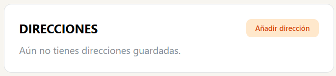
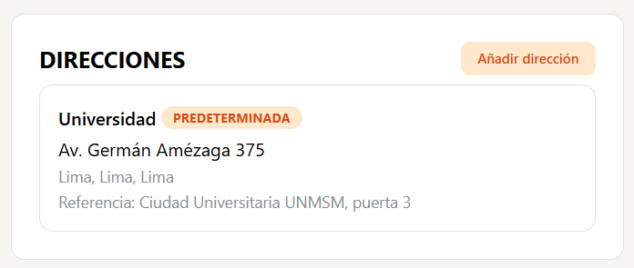
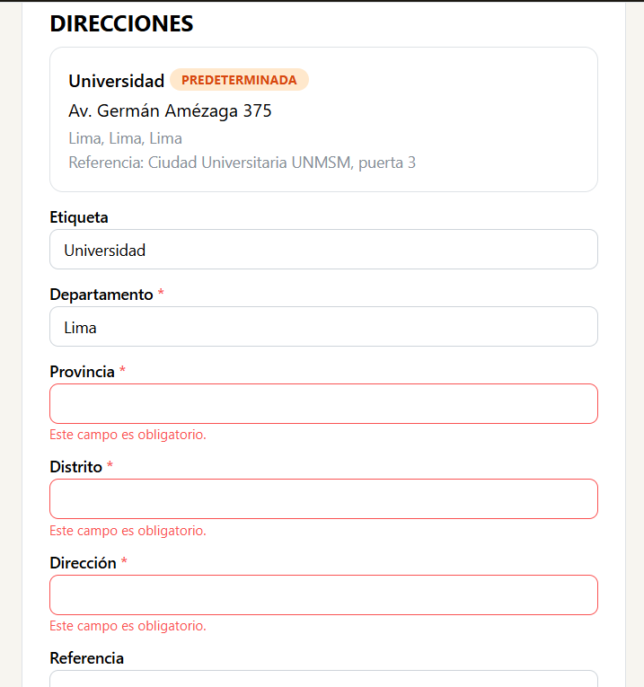
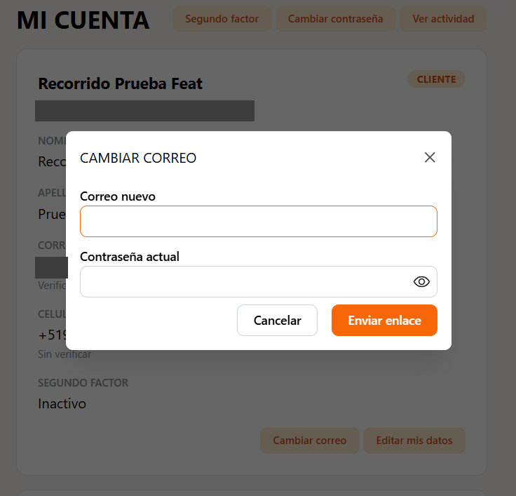
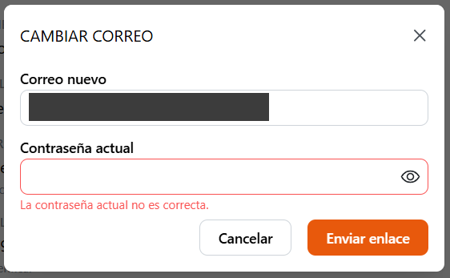
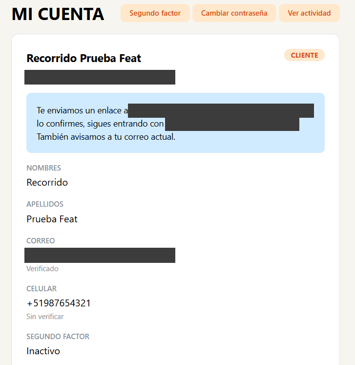
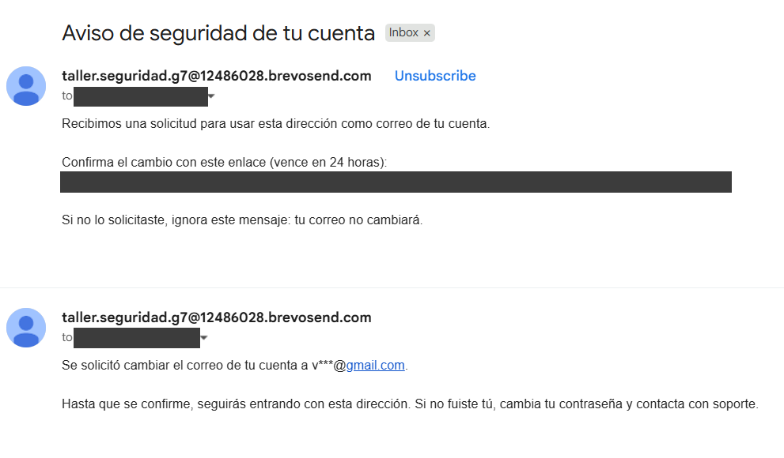
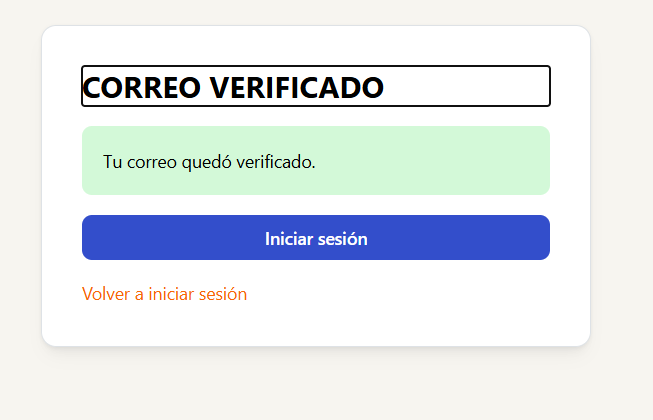
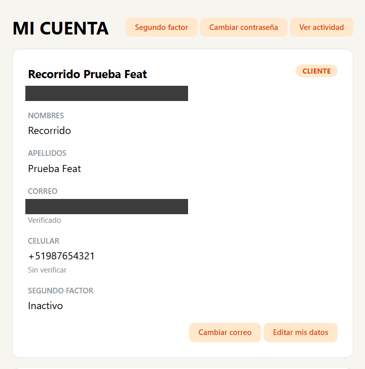

# FEAT-04 — Direcciones, cambio de correo y edición administrativa (cierre H5)

Responsable: Valery Cristin Gutierrez Bendezu. Corte: 23-nov-2026, America/Lima.
Estado: **T1–T4 y T6 fusionadas como código en `develop`; T5 es la evidencia desplegada que trae este
documento**: recorrido comprobado para direcciones y cambio de correo. La edición administrativa (T6)
queda pendiente de recorrido en Render por falta de acceso a una cuenta ADMIN_SISTEMA (ver «Límites»).
Nivel de evidencia: **propia desplegada** + CI.

Capturas recortadas, sin barra de direcciones, con los correos y el enlace de verificación tapados.
El celular `+51987654321` es un dato de prueba.

## Fuentes y versiones

SPEC-16, FRONT-06 (Mi cuenta), FRONT-08 (detalle administrativo), OpenAPI v1
(`/usuarios/{id}/direcciones`, `/usuarios/{id}/correo`, `/auth/verificar-correo`,
`PATCH /usuarios/{id}/atributos`) y catálogos de errores y eventos.

| Tarea | Componente | PR fusionado | Commit de merge | Fecha |
|---|---|---|---|---|
| T1–T2 Direcciones y `ConsultaDireccionesPort` | Backend | [#68](https://github.com/Taller-SW-Web/Modulo-de-Seguridad-Backend/pull/68) | `a8ac7df768264fc7c2d99ae2fa32bfdb274ba04b` | 23-oct |
| T3 Solicitud de cambio de correo | Backend | [#70](https://github.com/Taller-SW-Web/Modulo-de-Seguridad-Backend/pull/70) | `6091c9d0404f75cc71787826f1497a3c5f3bc724` | 1-nov |
| T3 Confirmación por `/auth/verificar-correo` | Backend | [#82](https://github.com/Taller-SW-Web/Modulo-de-Seguridad-Backend/pull/82) | `38d6b1398498fd1307a23fb9f11b33768fffac2f` | 7-nov |
| T4 Mi cuenta: direcciones y cambio de correo | Frontend | [#15](https://github.com/Taller-SW-Web/G7-Modulo-de-Seguridad-Frontend/pull/15) | `71fd40f4675647ad420255213997bde06deb2c04` | 1-nov |
| T6 Edición administrativa (API) | Backend | [#83](https://github.com/Taller-SW-Web/Modulo-de-Seguridad-Backend/pull/83) | `2d7f3850f9529caf554a78bf0bc9d0c173cbc266` | 7-nov |
| T6 Atributos de vendedor en FRONT-08 | Frontend | [#22](https://github.com/Taller-SW-Web/G7-Modulo-de-Seguridad-Frontend/pull/22) | `7fc2dbe80ebbf8e93defadcf59c159874ffaae6d` | 7-nov |

Versión del backend en Render el día del recorrido: `05ad567d16d1323c1b13711aeb83f6ee5f041254` (último
confirmado por David, 23-nov). Contiene los merges de backend de arriba (#68, #70, #82, #83); comprobado
con `git merge-base --is-ancestor`. La versión exacta del frontend no se registró.
El recorrido muestra en funcionamiento las pantallas y respuestas de #15, #70 y #82.

Relacionado: el PR de duplicado de la confirmación de correo
([#81](https://github.com/Taller-SW-Web/Modulo-de-Seguridad-Backend/pull/81)) se cerró sin fusionar; los
efectos de la edición propia (evento y auditoría) llegan con
[#62](https://github.com/Taller-SW-Web/Modulo-de-Seguridad-Backend/pull/62) (EP-08-T007, CI en verde).

## Recorrido desplegado

Ejecutado por Valery el 23-nov-2026 entre las 15:15 y las 15:22 (America/Lima) en
https://g7-seguridad-spa.onrender.com.

**Cuenta:** CLIENTE nueva creada desde la SPA para este recorrido, con un alias del correo de Valery,
verificada y sin MFA (no es de la demo ni de las pruebas de carga). El cambio de correo se hizo hacia
otro alias del mismo buzón, así llegan los dos mensajes: el enlace al correo nuevo y el aviso al anterior.

### Direcciones (T1–T2, T4)

| # | Paso | Resultado esperado | Resultado | Captura |
|---|---|---|---|---|
| 1 | Mi cuenta → sección Direcciones | Lista vacía o actual; solo visible con rol CLIENTE | «Aún no tienes direcciones guardadas» y botón «Añadir dirección» |  |
| 2 | Agregar dirección válida, marcada como predeterminada | 201; aparece en la lista y como predeterminada | Aviso «Guardamos tu dirección»; la dirección aparece con la etiqueta PREDETERMINADA |  |
| 3 | Agregar con Provincia, Distrito y Dirección vacíos | Error bajo el campo, sin enviar | «Este campo es obligatorio.» bajo cada campo vacío; no se guarda nada |  |

### Cambio de correo (T3–T4)

| # | Paso | Resultado esperado | Resultado | Captura |
|---|---|---|---|---|
| 4 | Mi cuenta → Cambiar correo | Pide contraseña actual y correo nuevo | Modal con «Correo nuevo», «Contraseña actual» y «Enviar enlace» |  |
| 5 | Enviar con contraseña incorrecta | Error del catálogo; el correo no cambia | «La contraseña actual no es correcta.»; el correo sigue igual |  |
| 6 | Enviar con datos correctos | Mensaje de revisar el correo nuevo; el correo actual sigue igual | «Te enviamos un enlace a … Hasta que lo confirmes, sigues entrando con … También avisamos a tu correo actual.»; Correo sigue siendo el anterior, Verificado |  |
| 7 | Correo recibido en la dirección nueva | Enlace a `/verificar-correo` con su vigencia | «Aviso de seguridad de tu cuenta» (Brevo): enlace a `/verificar-correo?token=…`, vence en 24 horas |  |
| 8 | Aviso recibido en la dirección anterior | Aviso del cambio solicitado | Mismo asunto: «Se solicitó cambiar el correo de tu cuenta a v***@gmail.com. Hasta que se confirme, seguirás entrando con esta dirección.» Destino enmascarado | (misma captura) |
| 9 | Abrir el enlace | Correo confirmado | «Correo verificado. Tu correo quedó verificado.» |  |
| 10 | Iniciar sesión con el correo nuevo | Entra; Mi cuenta muestra el correo nuevo | Entra; Correo = el nuevo, Verificado; nombres y celular sin cambios |  |

### Edición administrativa (T6) — pendiente

No ejecutado: requiere una cuenta ADMIN_SISTEMA (con MFA por rol de gestión), solicitada al equipo.
Guion pendiente:

| # | Paso | Resultado esperado |
|---|---|---|
| 11 | Admin → detalle de `vendedor.v` | Sección de atributos de vendedor visible |
| 12 | Cambiar la tienda y guardar | 200; el valor nuevo queda al recargar |
| 13 | Actividad / auditoría de la cuenta | `ATRIBUTOS_ACTUALIZADOS` con nombres de campo, sin valores |

## Pruebas automatizadas

- Backend: pruebas de persistencia y HTTP de direcciones (#68), cambio y confirmación de correo con
  receptor SMTP local (#70, #82) y edición administrativa (#83). CI en verde en cada PR.
- Frontend: Vitest de `SeccionDirecciones`, `CambioCorreo`, `validarCorreo` (#15) y
  `SeccionAtributosVendedor` (#22). CI en verde.

## Límites

- **Edición administrativa (T6) sin recorrido desplegado:** sin acceso a una cuenta ADMIN_SISTEMA el
  23-nov. Queda acreditada por CI (#83, #22); se agrega aquí si se consigue el acceso.
- No se recorrieron en el despliegue: dirección de otra cuenta (403/404), correo ya usado (respuesta
  neutra), enlace vencido o ya usado. Quedan cubiertos por las pruebas automatizadas.
- No se probó el ingreso con el correo anterior después de confirmar el cambio.
- No se registró el SHA desplegado del frontend; el recorrido muestra en funcionamiento las pantallas de #15.
- El documento de identidad no se edita: falla cerrado mientras no exista la clave AES (Christian).
