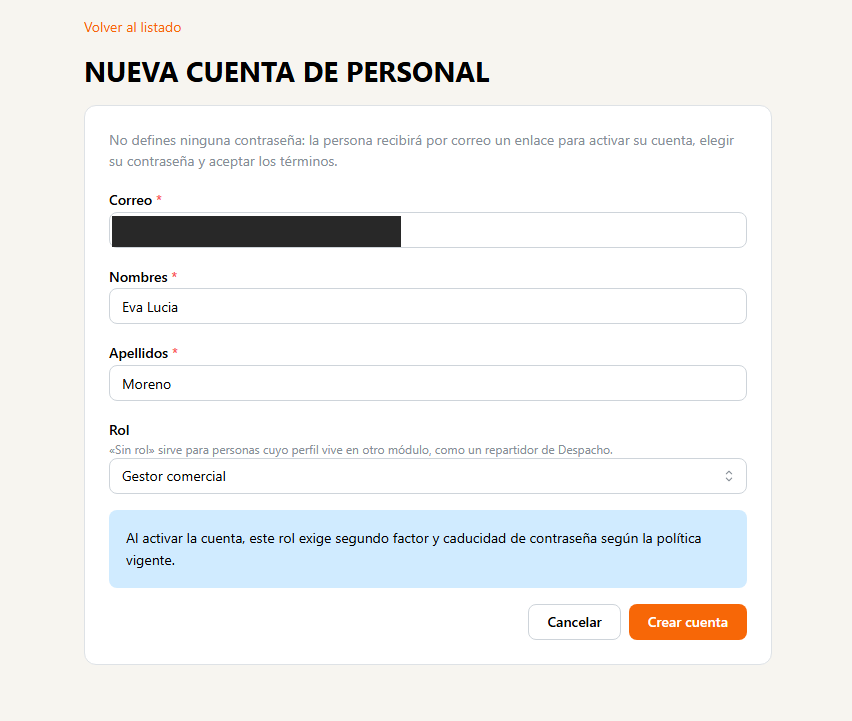
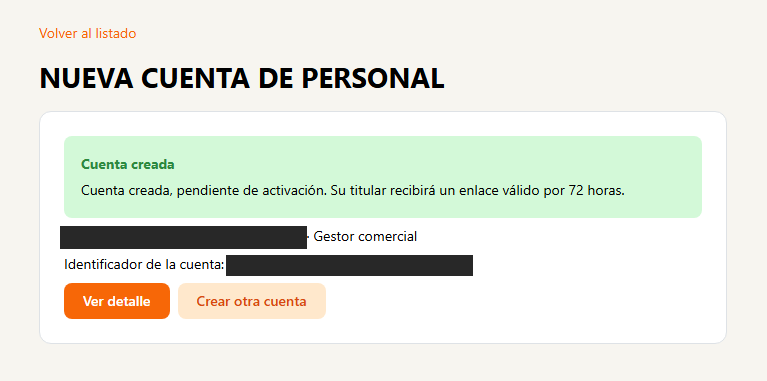
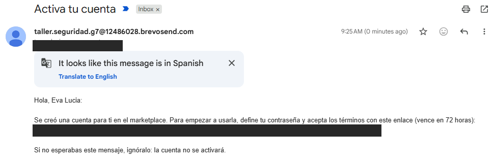
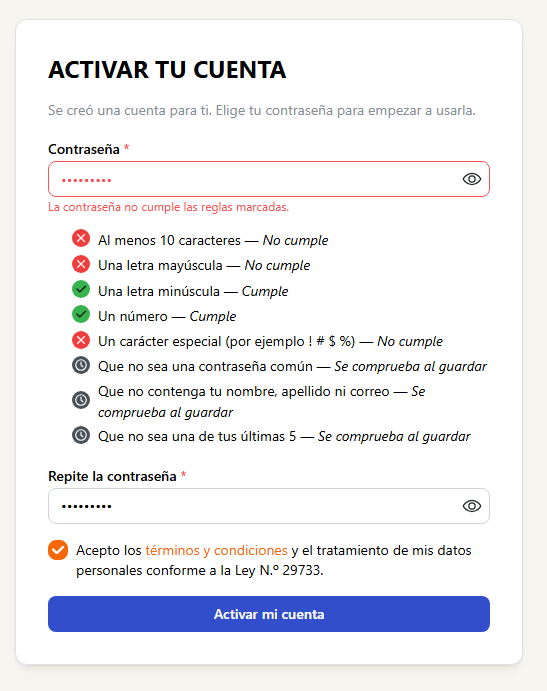
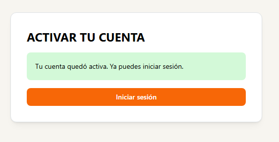
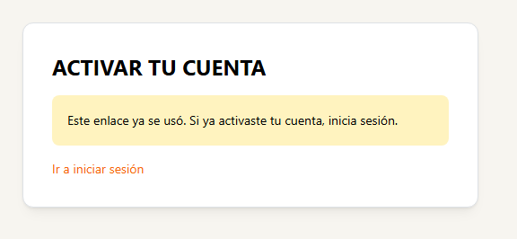
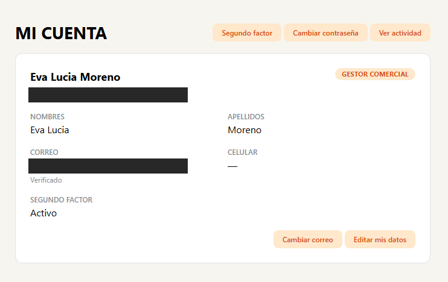
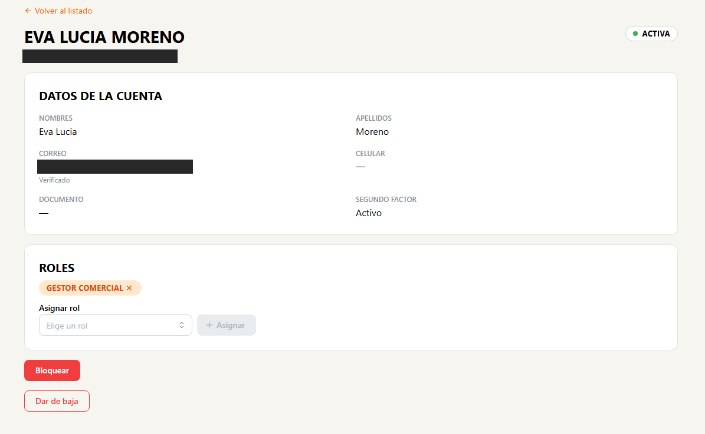
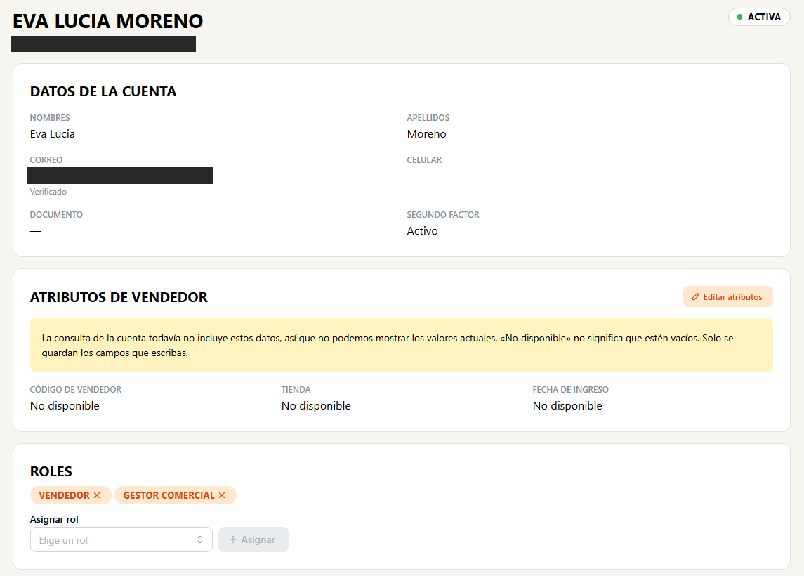

# FEAT-13 — Alta administrativa de personal y activación de cuenta, en el despliegue

Responsable: Eva Lucía Moreno Zevallos. Corte: 23-nov-2026, America/Lima.
Estado: **FEAT-13-T1 a T3 cumplidas: un administrador crea un gestor, el gestor activa su cuenta con
el enlace del correo, inicia sesión con su rol y recibe un segundo rol desde el detalle.** El caso
del enlace vencido quedó decidido por el PO el 28-nov y se declara como límite en H5 (ver al final).

Responde a la observación del profesor recogida en el [plan H5](../../../plan/hito-5/README.md): «no
se ve un superadministrador que dé roles de gestor».

## Fuentes y versiones

| Componente | Referencia |
|---|---|
| Especificación | [SPEC-03](../../../specs/funcionales/SPEC-03-alta-consulta-cuentas.md) RF-03.1, RF-03.3, RF-03.4 y RF-03.5; [FRONT-11](../../../specs/front/FRONT-11-admin-alta-usuario.md); alcance en [decisiones del PO](../../../plan/hito-5/DECISIONES-PO.md) §3; issue [#36](https://github.com/Taller-SW-Web/Modulo-de-Seguridad/issues/36) |
| Contrato | [OpenAPI v2](../../../specs/contrato-api/openapi-v2.yaml) `crearUsuarioV2` y [OpenAPI v1](../../../specs/contrato-api/openapi.yaml) `activarCuenta` |
| Backend | [#93](https://github.com/Taller-SW-Web/Modulo-de-Seguridad-Backend/pull/93), merge `05ad567d16d1323c1b13711aeb83f6ee5f041254`, aprobado por Sergio y Luis. Live en Render según David (17-nov); el job de despliegue del CI de ese commit falló porque Render ya tenía otro despliegue en curso, así que el despliegue no quedó verificado por el pipeline |
| Frontend | [#28](https://github.com/Taller-SW-Web/G7-Modulo-de-Seguridad-Frontend/pull/28), merge `a7064178928727c30279cae6e2dfd0aba2dfee41`, revisado por Luis. Desplegado por David el 23-nov; el bundle servido (`index-9oQgVo7i.js`) trae «Nueva cuenta de personal», «Activar mi cuenta» y los términos `2026-11-v1` |
| URL | https://g7-auth-service.onrender.com · https://g7-seguridad-spa.onrender.com |

## Recorrido desplegado (FEAT-13-T3)

**Nivel de evidencia:** propia desplegada. **Fecha:** 23-nov-2026, de 09:24 a 09:36, America/Lima
(hora de cada captura). **Ejecutó:** Eva.

- **Administrador:** una cuenta `ADMIN_SISTEMA` del despliegue, en una ventana normal.
- **Gestor:** cuenta nueva creada en el recorrido con un alias del correo de Eva, abierta en una
  ventana de incógnito para no mezclar sesiones.
- Capturas recortadas sin barra de direcciones. El correo, el enlace del correo y el identificador
  de la cuenta están tapados con rectángulos sólidos.

| # | Hora | Paso | Resultado | Captura |
|---|---|---|---|---|
| 1 | 09:24 | Admin → Usuarios → «Nueva cuenta»: correo, nombres, apellidos y rol **Gestor comercial** | Formulario sin contraseña; aviso de que el rol exige segundo factor y caducidad (UI-11.2) |  |
| 2 | 09:25 | «Crear cuenta» | `201`: «Cuenta creada, pendiente de activación. Su titular recibirá un enlace válido por 72 horas.», con el rol y el identificador (UI-11.1) |  |
| 3 | 09:25 | Correo «Activa tu cuenta» | Llegó en el mismo minuto, enviado por Brevo, con el enlace a `/activar-cuenta` y vigencia de 72 horas |  |
| 4 | 09:27 | Abrir el enlace y probar la contraseña `vendedor1` | `422 POLITICA_INCUMPLIDA`: el medidor marca longitud, mayúscula y carácter especial (ESC-03.4) |  |
| 5 | 09:28 | **Con el mismo enlace**, una contraseña válida | `204`: «Tu cuenta quedó activa.». La contraseña débil no gastó el enlace (ESC-03.4, pedido de Sergio en #93) |  |
| 6 | 09:31 | Abrir el mismo enlace otra vez y enviar | `410 ENLACE_YA_USADO`: «Este enlace ya se usó.» |  |
| 7 | 09:33 | Login del gestor | Pidió el código por correo (rol de gestión, RF-10.1) y entró a «Mi cuenta» con **Gestor comercial**, correo verificado y segundo factor activo |  |
| 8 | 09:35 | Admin → detalle del gestor | Estado **Activa**, rol Gestor comercial |  |
| 9 | 09:36 | Admin asigna un segundo rol desde el detalle | Roles **Vendedor** y **Gestor comercial** |  |

**Resultado:** cumple FEAT-13-T3.
- El administrador creó al gestor sin conocer ni definir su contraseña (acuerdo A6).
- La cuenta solo pudo usarse después de que su titular la activó con el enlace.
- El enlace sirvió una sola vez y un intento con contraseña débil no lo gastó.
- El gestor entró con su rol y con el segundo factor obligatorio.

### Comprobación previa en Render (17 y 22-nov)

El 17-nov, `POST /api/v1/auth/activar-cuenta` con un token desconocido respondía `401
TOKEN_INVALIDO` en lugar de `410`, mientras `verificar-correo` sí respondía `410`. La causa probable
era que el enum `proposito_token` de la base de Render no tuviera `ACTIVACION`. David lo corrigió
en la base, sin cambios de código. El 22-nov la misma petición respondió `410 ENLACE_YA_USADO`, y el
recorrido del 23-nov emitió y consumió el token de activación sin errores.

## Pruebas automatizadas

- Backend (#93): 1218/1218 con Docker y CI en verde. Las nuevas son `AltaPersonalServiceTest` (7),
  `ActivacionCuentaServiceTest` (6), `AltaPersonalHttpTest` (15), `ActivacionCuentaHttpTest` (10) y
  `AltaAdministrativaPostgresTest` (9): enlace de 72 h cifrado en el outbox, `usuario.creado` solo al
  activar y con los roles, contraseña débil sin gastar el enlace, enlace vencido, correo repetido,
  sin permiso, outbox caído y reenvío de verificación sobre una cuenta del administrador.
- Frontend (#28): 222/222 y CI en verde. `AdminAltaPage.test.tsx` cubre UI-11.1 a UI-11.6 y el botón
  del listado; `ActivacionCuentaPage.test.tsx` cubre los 410, el 422, los términos y la sesión previa;
  `TerminosPage.test.tsx` cubre la página de términos.

## Enlace vencido — decidido por el PO (28-nov)

El contrato de `activarCuenta` dice: «Si [el enlace] venció, un administrador o el vendedor puede
reenviarlo con un alta nueva sobre la misma cuenta, o el titular puede usar la recuperación de
contraseña». Hoy ninguna de las dos salidas funciona:

- **Alta nueva con el mismo correo:** responde `409 CORREO_NO_DISPONIBLE` (ESC-03.3).
- **Recuperación de contraseña:** solo atiende cuentas `ACTIVO` o `BLOQUEADO`, y esta sigue
  `PENDIENTE_VERIFICACION`.

Por eso, una cuenta de personal cuyo enlace vence queda sin salida mientras no exista la eliminación
a los 30 días (RF-03.9, fuera de H5). Mientras tanto, la pantalla de activación dice «Contacta al
administrador de la plataforma para revisar tu activación» (revisión de Luis en #28).

Sergio dijo en #93 que responderá aparte y lo registrará en `DECISIONES-PO.md`. Las opciones son:
1. Que un alta sobre una cuenta `PENDIENTE_VERIFICACION` **sin términos aceptados** reemita el enlace
   e invalide el anterior. Sería un PR aparte del backend; las demás altas con ese correo seguirían
   en `409`.
2. Mantener el `409` y quitar del contrato la frase del reenvío, declarando el límite.

**Decisión del PO (28-nov, [`DECISIONES-PO.md`](../../../plan/hito-5/DECISIONES-PO.md)):** opción 1
como comportamiento final, que es lo que ya dice el contrato. Se implementa después del H5. En H5 se
declara como límite: si vence el enlace de una cuenta de prueba, David la elimina en Supabase y el
administrador la vuelve a dar de alta.

## Límites

- **No se recorrieron en el despliegue:** el alta **sin rol** (UI-11.4), el `409` por correo
  repetido, el enlace vencido y el alta sin `usuario.ver` (UI-11.6). Están cubiertos por las pruebas
  automatizadas.
- **Eventos:** no se observó `usuario.creado` en el broker; la prueba PostgreSQL comprueba que se
  guarda al activar, con los roles, y que el alta no publica nada.
- **Cuentas antiguas sin términos:** Sergio y Luis pidieron en #93 contar las cuentas
  `PENDIENTE_VERIFICACION` con `acepta_terminos = false` antes de desplegar, porque desde #93 ya no
  pueden verificar su correo. Esta evidencia no registra el resultado de esa consulta.
- **Versión de términos guardada: `1.0`, no `2026-11-v1`.** La pantalla muestra y enlaza
  `2026-11-v1`, pero el backend guarda la versión que indica `G7_REGISTRO_VERSION_TERMINOS`. Esa
  variable no está configurada en Render, así que usa su valor por defecto, `1.0`. Eva lo comprobó el
  23-nov con una consulta de solo lectura en Supabase:

  | Cuenta | `version_terminos` | `fecha_aceptacion` (UTC) | `acepta_terminos` |
  |---|---|---|---|
  | Gestor (FEAT-13) | `1.0` | 2026-11-23 14:28:28 (09:28 en Lima, la activación del paso 5) | `true` |
  | Cliente de FEAT-02 | `1.0` | 2026-11-23 14:37:52 (09:37 en Lima, su registro) | `true` |

  La aceptación y la fecha se guardan bien; lo que falla es la versión. Se corrige configurando
  `G7_REGISTRO_VERSION_TERMINOS=2026-11-v1` en Render, sin cambiar código. Las cuentas ya creadas
  conservan `1.0` hasta que el PO decida si se corrigen (H-12).
- **RF-03.9:** la eliminación a los 30 días de las cuentas sin activar no entra en H5 (issue #37).
  La cuenta del gestor de esta prueba queda activa con dos roles.
- La sección «Atributos de vendedor» que aparece en el detalle tras asignar `VENDEDOR` (captura 9)
  es de FEAT-04 y no forma parte de esta evidencia.
- No se incluyen contraseñas, tokens, enlaces de correo ni datos personales completos.
