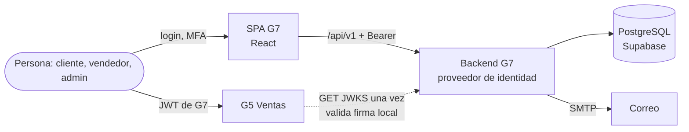
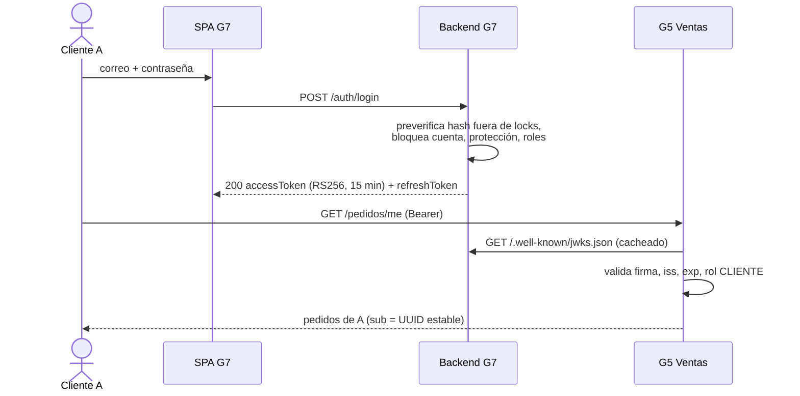
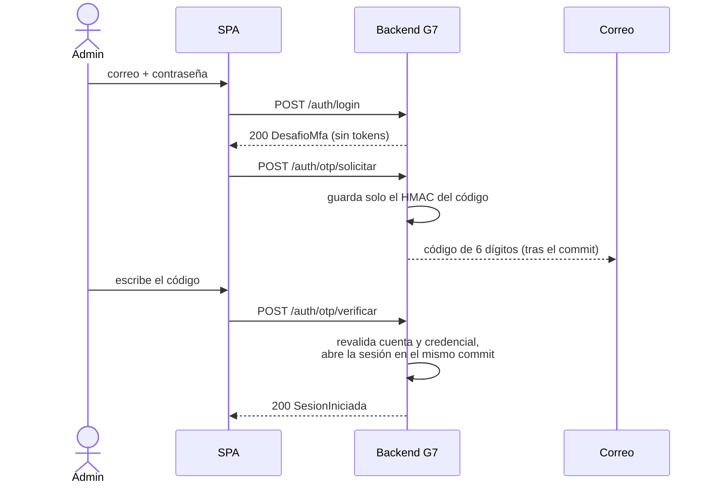
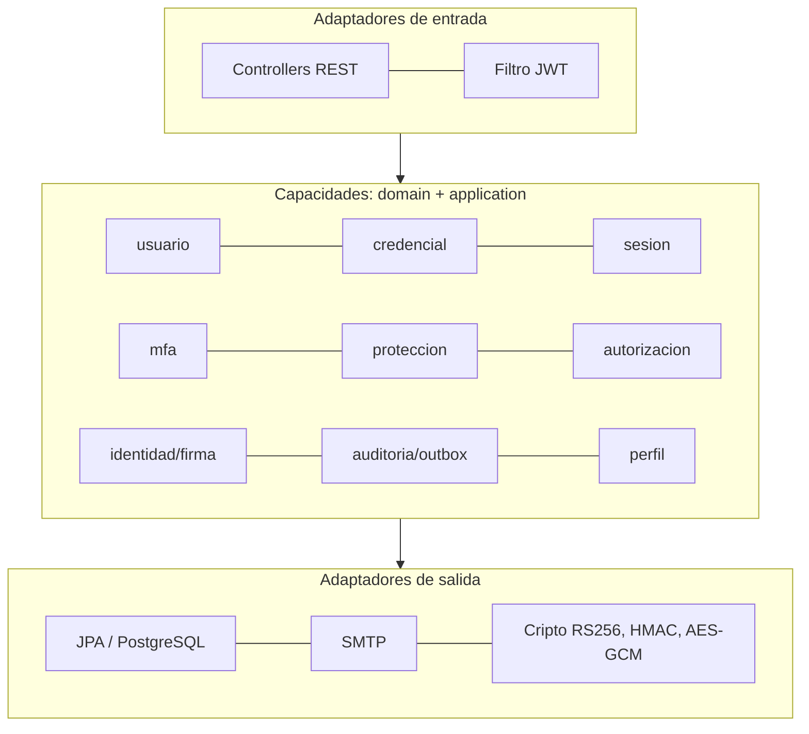
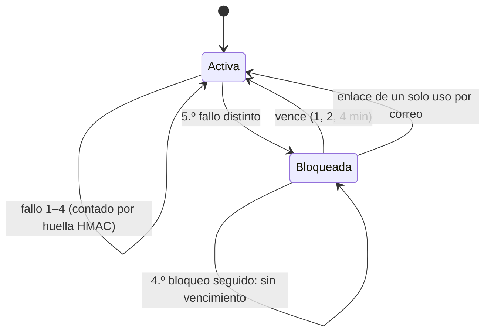
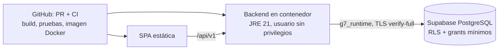

# Hito 3 — Material para la presentación (Canva)

Módulo de Seguridad (G7), marketplace del curso Taller de Construcción de Software
Web, UNMSM 2026-II. Preparado por Sergio Osorio (PO) el 15-oct-2026 a partir del
código fusionado en `develop` de los repositorios de backend y frontend.

---

## 1. Descripción (10 %)

**Qué es.** El G7 es el **proveedor de identidad** del marketplace: registra y
autentica a las personas, emite los tokens con los que el resto de módulos (Ventas,
Despacho, Productos…) sabe quién llama y con qué permisos, y protege las cuentas.

**Qué entrega el Hito 3**

| Capacidad | Qué se ve en la demo |
|---|---|
| Inicio de sesión | Correo + contraseña → JWT **RS256** de 15 min + refresco de 7 días |
| Segundo factor (MFA) | Obligatorio para roles de gestión: código de 6 dígitos por correo, 3 intentos, 5 min |
| Sesiones | Refresh con rotación, detección de reúso (revoca la familia) y logout |
| Protección | 5 fallos → bloqueo automático (1, 2, 4 min; desde el 4.º sin vencimiento) con enlace de desbloqueo por correo |
| Roles y permisos | 6 roles del catálogo; el admin asigna/revoca; nunca se queda el sistema sin administrador |
| Panel de administración | Listado con filtros, detalle de cuenta, bloqueo visible y gestión de roles |
| Mi cuenta | Perfil propio leído del backend |
| Integración | JWKS público: **G5 (Ventas) valida nuestro JWT sin llamarnos** y responde `GET /pedidos/me` |
| Auditoría y mensajería | Registro de seguridad sin secretos; outbox con correos cifrados (AES-256-GCM) |

**Tecnología.** Backend Java 21 + Spring Boot 3.5 en arquitectura hexagonal,
PostgreSQL (Supabase), Flyway; frontend React 19 + Vite 7 + Mantine 9; Docker;
CI en GitHub Actions; contrato OpenAPI.

**Cifras (15-oct).** Backend ≈ 600 pruebas automáticas, frontend 40; 40+ PR
fusionados con CI verde; recorridos reales contra PostgreSQL con el usuario de
mínimo privilegio `g7_runtime`.

---

## 2. Diagramas (20 %)

### 2.1 Contexto: G7 dentro del marketplace

### 2.2 Secuencia de la demo: login G7 → JWT → G5

### 2.3 Login con segundo factor (administrador)

### 2.4 Arquitectura hexagonal del backend

Reglas comprobadas por ArchUnit en el CI: el dominio no depende de Spring/JPA; una
capacidad solo consume a otra por sus puertos y DTO exportados mediante un puente.

### 2.5 Bloqueo automático y desbloqueo

### 2.6 Despliegue

---

## 3. Uso de IA (15 %)

Se usó un asistente de IA (Claude Code) como **par de programación y revisor**,
siempre con verificación humana y evidencia ejecutada. Ejemplos concretos:

| Uso | Ejemplo real | Cómo se verificó |
|---|---|---|
| Revisión de PR | Encontró que el filtro de secretos de auditoría dejaba pasar `refreshToken` y `contrasenaNueva` | Pruebas nuevas + mutación: al quitar el filtro fallan 14 pruebas |
| Ensayo de migraciones | Ensayó la ventana de Supabase en un PostgreSQL desechable con los permisos reales | 26/26 comprobaciones; descubrió que faltaban permisos sobre una vista y para el lock del catálogo, que habrían roto el login en producción |
| Pruebas de mutación | Se rompe a propósito una regla (p. ej. CORS, renovación compartida del token) para comprobar que alguna prueba falla | Cada PR documenta las mutaciones detectadas |
| Integración | Login, OTP, bloqueo y roles probados de punta a punta contra la base real como `g7_runtime` | Scripts de recorrido con resultado OK/FALLO en la evidencia |
| Documentación | Runbook de la ventana, guía de despliegue, evidencias por tarea | Revisadas contra el código y los ensayos |

**Límites y criterio.** La IA no tuvo acceso a secretos en git ni en el código; las
contraseñas y claves viven en variables de entorno. Cuando el control de permisos
bloqueó acciones sobre la base de producción, se detuvo y se pidió autorización.
Toda sugerencia se aceptó solo con pruebas en verde y revisión del responsable.

---

## 4. Guion breve de la demo (25 %)

1. Abrir la SPA → iniciar sesión con la cuenta A (cliente) → «Mi cuenta».
2. Mostrar el JWT (cabecera `kid`, `sub`, `roles`) y el JWKS público.
3. G5: con el mismo token, `GET /pedidos/me` devuelve los pedidos de A; con B, lista vacía; con V (sin CLIENTE), 403.
4. Contraseña errónea / correo inexistente: el mismo mensaje (no se enumeran cuentas).
5. Administrador: login → código por correo → panel → asignar un rol → la sesión del usuario se revoca.
6. Cuenta L: 5 fallos → bloqueada → enlace por correo → desbloqueo.

Fuentes de detalle: `docs/evidencia/*.md` del backend (EP-02-T006, EP-01-T007,
TEC-INFRA-T005…) y `docs/despliegue/DESPLIEGUE-T005.md`.
