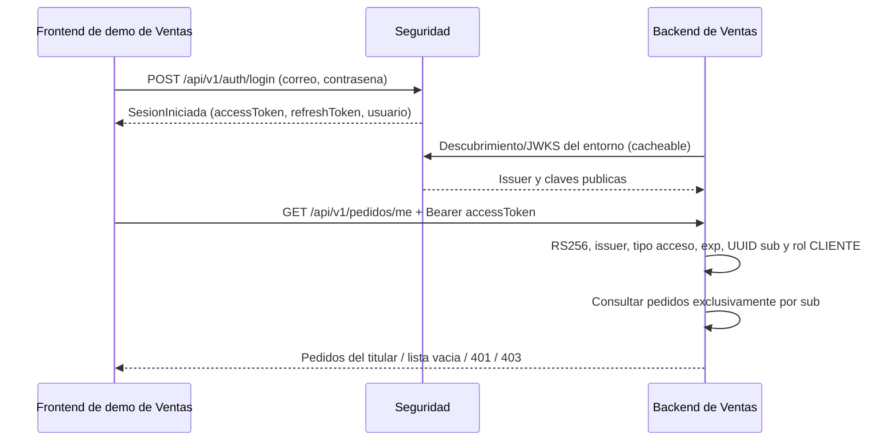

# Plan técnico Hito 3 — login real y mis pedidos con Ventas

| Campo | Valor |
|---|---|
| ID / versión / corte | H3-VENTAS / 0.1.0 / 12-oct-2026 |
| Estado | Preparado documentalmente; revisión y condiciones de inicio pendientes |
| Coordinación | Sergio; cada dueño implementa su capacidad completa |
| Acuerdo | A11, confirmado en G5 Backend #2; A10 sigue siendo integración de servicio |
| Objetivo | Ambos servicios y prueba conjunta el jueves 15/10; presentación sábado 17/10 |

Este es el plan del recorrido entre módulos. **No sustituye los ocho planes
individuales ni acredita implementación o despliegue.**
[Flujo SDD](flujo-sdd.md), [índice individual](funcionalidades/README.md),
[condiciones pendientes](DECISIONES-Y-BLOQUEOS.md).

## 1. Entradas y revisión contractual

- [Ficha bilateral](../docs/integracion/hito-3-ventas.md) y
  [A10/A11](../docs/integracion/acuerdos.md).
- EP-02: [SPEC-05](../specs/funcionales/SPEC-05-inicio-sesion.md),
  [SPEC-06](../specs/funcionales/SPEC-06-renovacion-cierre-sesion.md),
  [UI FRONT-01](../specs/front/FRONT-01-inicio-sesion.md),
  [React FRONT-01](../specs/componentes-react/FRONT-01-inicio-sesion.md)
  y [base de sesión](../specs/front/FRONT-00-comportamiento-comun.md).
- Identidad técnica: [SPEC-17](../specs/funcionales/SPEC-17-tokens-servicio.md),
  [contrato v1](../specs/contrato-api/openapi.yaml),
  [kit](../specs/kit-integracion.md),
  [errores](../specs/catalogo-errores.md) y
  [ADR-001](../docs/arquitectura/adr/001-rs256-frente-a-hs256.md).
- Dependencias de sus dueños: [cuentas EP-01](../specs/epicas/EP-01-registro-gestion-usuarios.md),
  [credenciales SPEC-07](../specs/funcionales/SPEC-07-politica-cambio-contrasena.md),
  [roles SPEC-11](../specs/funcionales/SPEC-11-roles-permisos.md),
  [auditoría SPEC-12](../specs/funcionales/SPEC-12-registro-auditoria.md),
  [bloqueo SPEC-14](../specs/funcionales/SPEC-14-bloqueo-automatico.md)
  y [MFA SPEC-09](../specs/funcionales/SPEC-09-mfa-inicio-sesion.md).
- [Fuentes fijadas](../docs/fuentes-oficiales.md): base pública v1 1.0.0;
  revisión local v1 1.1.0 y v2 parcial 2.0.0. El SHA consumido se fija después
  de publicar; no se presenta un hash local como commit público.

El recorrido usa operaciones existentes de v1. No depende de la configuración
MFA/alta v2 ni añade endpoints de Seguridad. Las
[validaciones previas](../docs/integracion/validacion-hito-3.md) comprueban
contratos/kit, no los servicios de este plan.

## 2. Resultado y límites

Una persona inicia sesión con su cuenta de Seguridad desde la demostración de
Ventas. Ventas recibe el token de acceso de esa persona, valida firma/identidad
y muestra solo sus pedidos persistidos. Cliente A tiene pedidos, B no tiene
ninguno y un vendedor V permite comprobar la denegación por rol.

La llamada del frontend a Seguridad es el transporte descrito en la ficha
actual; G5 confirma su implementación concreta en INT-05. Si la realiza su
backend, se documenta ese transporte antes de conectar, manteniendo la identidad
del usuario y los formatos acordados. No se requiere un flujo SSO nuevo ni
trasladar tokens por una URL entre las dos aplicaciones.

Quedan fuera de **esta demostración conjunta** checkout, pagos, stock,
Despacho, registro/verificación por canal, scopes/clientes A10 e introspección.
El desarrollo de las ocho épicas continúa y no se reduce al recorrido anterior.

## 3. Entregables y dependencias internas

| Capacidad | Dueño | Aporta al recorrido | Criterio antes de conectar |
|---|---|---|---|
| Cuenta y fixtures | Eva — EP-01 | UUID y estado de cuenta válidos | A/B CLIENTE activos, V VENDEDOR, sin MFA voluntario; carga reproducible revisada |
| Credenciales | Juan José — EP-03 | Verificación del hash y caducidad | Login consume esta regla; no hay hashes/contraseñas ficticios ni regla duplicada |
| Protección | Luis David — EP-07 | Estado efectivo, intentos y bloqueo | Login no emite tokens para cuenta no disponible; contador/transiciones mantienen SPEC-14 |
| Segundo factor | Luis David — EP-04 | Determinación/desafío para cuentas que lo exigen | Una cuenta con MFA efectivo nunca recibe la respuesta de sesión antes de verificarlo |
| Roles/permisos | Sergio — EP-05 | Roles múltiples y unión de permisos de Seguridad | CLIENTE procede del dominio, no de un campo enviado por el navegador |
| Auditoría | Christian — EP-06 | SESION_INICIADA/SESION_FALLIDA y demás acciones aplicables | Registros sin secretos; criticidad y reintento de SPEC-12 |
| Login y sesión | Jose Luis — EP-02 | Composición, tokens, familia y respuesta contractual | Servicio real y persistencia de sesión; pruebas de login y denegación |
| Firma y publicación de claves | Sergio — identidad técnica | RS256/kid, issuer y JWKS | Token real verificable mediante las claves públicas del entorno |
| Despliegue/comprobación | Christian — infraestructura | HTTPS y configuración de entregables | Ambos servicios disponibles y comprobados, sin atribuirse capas ajenas |
| Pedidos/pantalla/JWT | Michael — Ventas F1 | Validación, propiedad por sub y consulta | Rama publicada y casos A/B/V en su servicio real |

Son capacidades a consumir, no nuevas asignaciones por capas. El plan de cada
dueño definirá su interfaz interna antes de crear tareas consumidoras. No se
crean endpoints privados entre las épicas del mismo backend solo por repartir
trabajo: son colaboraciones internas de dominio.

## 4. Decisiones técnicas del incremento

**Login.** Entrada JSON `correo`/`contrasena`, operación pública. Jose Luis
consulta cuenta/estado, consume credenciales y caducidad, protección, roles,
MFA y auditoría. El `200` distingue `SesionIniciada` de `DesafioMfa`; un desafío
no establece sesión. `401 CREDENCIALES_INVALIDAS` permanece genérico para correo
inexistente, contraseña incorrecta y cuenta bloqueada/inactiva/sin verificar.
Se conserva `403 PASSWORD_CADUCADA` según la regla de credenciales.

**Sesión.** Éxito sin MFA: accessToken de 900 segundos, refreshToken de siete
días y nueva familia persistida, con los campos requeridos de `SesionIniciada`.
No devolver un refreshToken ficticio para completar el schema. Renovación/cierre
y reúso pertenecen a SPEC-06 y al plan de EP-02; se verificarán allí y no se
consideran implementados por esta demo de lectura. Cerrar/refrescar no implica
invalidar inmediatamente un token de acceso validado localmente por Ventas.

**Firma/validación.** RS256, `kid`, issuer exacto del descubrimiento,
`tipo: "acceso"`, UUID en `sub`, `iat`, `exp`, `jti`, roles como array y permisos de
Seguridad. No exigir audiencia de servicio al usuario ni añadir un `aud`
improvisado. Ventas exige CLIENTE después de validar el token, y obtiene el
titular de `sub`. Ni `customerId` ni `usuario.id` recibido desde el navegador
sustituyen esa identidad. La clave privada solo está en Seguridad.

**Descubrimiento/JWKS.** Ambos GET públicos del contrato v1. El issuer se
configura por entorno, no como `auth-service`. Ventas cachea el JWKS. El par
RSA permanece estable entre reinicios; publicar solo parámetros públicos.
Omitir capacidades opcionales de descubrimiento no disponibles en el despliegue
de demo; no anunciar token/introspección operativos si todavía no lo están.
La rotación con convivencia de claves sigue siendo requisito de SPEC-17 y se
planifica allí; esta demo no demuestra esa rotación.

**Datos/transacciones.** PostgreSQL y Flyway existentes son el punto de partida,
con `ddl-auto: validate`. Revisar migraciones realmente aplicadas antes de
modificarlas; nuevas diferencias usan migraciones nuevas. La sesión/familia no
queda emitida a medias si su persistencia falla. El bloqueo y la auditoría crítica
mantienen la transición atómica; la auditoría no crítica de login conserva el
reintento previsto. DAT-01 se resuelve por parte afectada, sin inventar una
tabla de familia o asociación `jti` pública no descrita.

**Frontend.** En G7, FRONT-01/base de sesión pertenecen a Jose Luis; la pantalla
de pedidos/login de G5 la entrega su equipo. Respuesta de desafío no muestra
pedidos ni entrega acceso. Tokens en memoria, no URL ni almacenamiento web
persistente; recarga pide login. La aceptación de este consumo por G5 sigue
pendiente en H-11/INT-05. Si renueva, se usa refresh serializado; nunca repetir
a ciegas una rotación cuyo resultado se desconoce.

**Runtime.** La base declara Java 21/Spring Boot 3.3.5 en su pom. Los fragmentos
del kit se comprobaron con Spring Security 6.5.0/JDK 23 y otros runtimes indicados
en la evidencia; eso no certifica las dependencias del backend. TEC-04 exige
resolver/verificar el árbol efectivo y probar el código en su runtime real,
sin cambiar versiones del proyecto durante esta planificación.

## 5. Configuración y datos que se deben cerrar

| Dato | Condición |
|---|---|
| Base HTTPS G7 / issuer / descubrimiento / JWKS | Valores reales del mismo entorno, issuer idéntico al claim iss |
| Base HTTPS G5 / origen frontend | Valores confirmados por Michael; sin inferirlos del mock |
| CORS | Orígenes concretos; métodos/cabeceras necesarios y Retry-After expuesto si lo consume la UI |
| PostgreSQL/Flyway y despliegue | Plataforma, conexión y cadena aplicada comprobadas por Christian/Jose Luis |
| RSA/kid y secretos | Custodia/persistencia definidas por Sergio/Christian, sin contenido secreto en Git |
| UUID A/B/V | Eva fija y comparte identificadores; G5 persiste pedidos de A y ninguno de B |
| Credenciales de prueba | Protocolo de fixture compatible con credenciales/política, por canal privado |
| Revisión consumida, rama y hora | SHA publicado y aceptación bilateral, rama G5 y prueba concreta en #2 |

No inventar aceptación de términos para cargar fixtures ni afirmar que se
ejecutó registro/activación. Eva define la carga técnica de pruebas con sus
dependencias y restricciones reales (TEC-02/H-12); H-12 sigue bloqueando ese
flujo de registro. La ficha contiene valores pendientes, no secretos.

## 6. Fases para derivar planes y tareas

| Fase | Entregable | Depende de | Comprobación |
|---|---|---|---|
| 1 | Planes de capacidades y revisión consumida | Specs y decisiones del incremento | RF/ESC, dueños e interfaces internas explícitos |
| 2 | Login/familia y firma/descubrimiento/JWKS reales locales | Capacidades de sus dueños, TEC-02/03/04 y persistencia necesaria | Pruebas API/DB/RS256 con errores y sin MFA omitido |
| 3 | Datos A/B/V y endpoint/pantalla de G5 locales | UUID confirmados y trabajo de Michael | CLIENTE, sub, pedidos persistidos y aislamiento |
| 4 | Servicios en nube y configuración bilateral | TEC-01, revisión publicada e INT-05 | HTTPS, issuer/JWKS y orígenes comprobados |
| 5 | Prueba conjunta, correcciones y ensayo | Fases reales conectadas; hora acordada | Casos siguientes y evidencia sanitizada de ambos servicios |

Estas fases no son un tablero de tareas ni una estimación de disponibilidad.
Los estados y tareas se escribirán después de revisar los planes individuales.
Jueves 15 es objetivo/compromiso registrado, no resultado ya obtenido.

## 7. Casos de aceptación y evidencia

| Caso | Resultado observable | Fuente |
|---|---|---|
| H3-C01, login A sin MFA | SesionIniciada real; UUID, roles y vigencia correctos; familia persistida | RF-05.1/6, ESC-05.1 y SPEC-06 |
| H3-C02, login inválido/no disponible | Sin tokens; 401 genérico sin revelar existencia/estado | RF-05.3/4, ESC-05.2/3/4, SPEC-14 |
| H3-C03, cuenta con MFA efectivo | Desafío, nunca sesión directa; no accesos privados | RF-05.2, ESC-05.5, RF-09.8 |
| H3-C04, descubrimiento y firma | Issuer exacto; claves públicas verifican el token real | RF-17.1/2/14, ESC-17.1 |
| H3-C05, pedidos de A | 200, exclusivamente pedidos persistidos de A | A11; contrato G5 §1.4b |
| H3-C06, B sin pedidos | 200, items vacío y total 0; paginación de G5 | A11; contrato G5 §1.4b |
| H3-C07, sin token/vencido/firma alterada | 401 en G5, sin datos de pedidos | A11 y validación de token de usuario |
| H3-C08, vendedor V autenticado | Token criptográficamente válido pero sin CLIENTE: 403 | A11; autorización por rol |
| H3-C09, B envía identidad ajena | El navegador no cambia el titular sub ni obtiene pedidos de A | A11; propiedad por sub |
| H3-C10, token de servicio como usuario | Rechazo como token de usuario; no acceso por un scope A10 | Kit y separación acceso/servicio |
| H3-C11, recarga | Sesión en memoria perdida, nuevo login; aceptación G5 pendiente | H-11/INT-05 |
| H3-C12, trazabilidad de login | Auditoría de éxito/fallo sin contraseña ni tokens completos | RF-05.7; RF-12.1/3/5/6 |

Casos C01–04/12 comprueban capacidades internas; C05–09/11 requieren G5 real y
configuración bilateral. C10 prueba el validador G5 con una fixture firmada
en un entorno aislado; no exige provisionar clientes ni implementar A10 para
esta demo. C03 es una protección que se verifica aunque no se
muestre un login MFA completo en la demo. Si la capacidad no está implementada,
no se declara validada ni se emiten tokens saltando el segundo factor.
Para el caso vencido de prueba conjunta, preparar un token real que ya haya
cumplido sus 15 minutos, sin cambiar la vigencia contractual de producción.

Guardar entorno, SHA de ambos servicios, hora, caso, petición sin secretos,
estado/respuesta sanitizada y revisión. Un JWT de fixture firmado puede probar
el validador; no sustituye login real, consulta SQL ni aislamiento de pedidos.
Los negativos adicionales del kit se repetirán sobre el validador implementado.

## 8. Inicio, terminado y recuperación

Un incremento interno puede comenzar cuando su plan/tareas y dependencias
aplicables estén listos. La conexión en nube requiere completar configuración,
fixtures, revisión y disponibilidad; no esperar otra aceptación del recorrido
que Ventas ya dio. Un pendiente ajeno no bloquea todo el módulo.

La demo conjunta termina con los casos reales aprobados, aislamiento A/B,
evidencia reproducible y ensayo. No cierra por sí sola EP-02, SPEC-17, las
otras siete épicas ni A10. H3-C11 requiere la aceptación que aún falta de G5.

Si hay caída/red/JWKS sin claves válidas, no aceptar un token por descodificar
su payload; mostrar error/denegación según contrato. Si la prueba conjunta
falla, registrar caso y dueño, corregir y repetir. No presentar resultados
de Prism como integración funcionando. Recuperar fixtures solo en entorno de
prueba y conservar la identidad acordada; nunca resetear una base compartida
por iniciativa de una prueba. Las horas pendientes determinan el margen real
entre jueves y sábado; no afirmar 48 horas exactas todavía.
